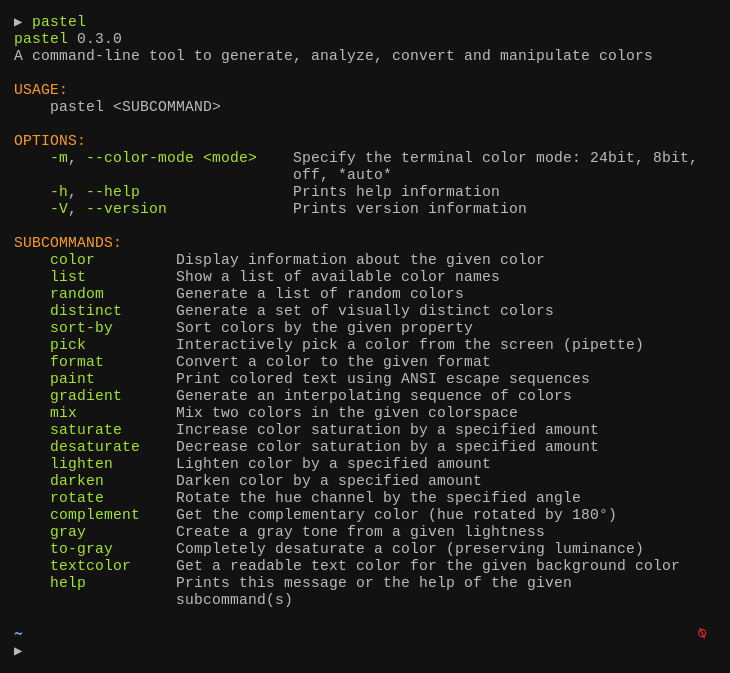

> **语言**：本文档为简体中文翻译，[点此查看英文原版 README.md](README.md)。

# pastel

[](https://github.com/sharkdp/pastel/actions)
[](https://github.com/sharkdp/pastel/releases)
[](https://crates.io/crates/pastel)
[](https://crates.io/crates/pastel)


`pastel` 是一个用于生成、分析、转换和操控颜色的命令行工具。它支持许多不同的颜色格式与色彩空间，例如 RGB（sRGB）、HSL、CIELAB、CIELCh，以及 ANSI 8 位和 24 位表示。

## 实际效果



## 教程

### 获取帮助

`pastel` 提供了许多命令，例如 `saturate`、`mix` 或 `paint`。要查看所有命令的完整列表，你可以直接运行
``` bash
pastel
```
要了解某个具体子命令（比如 `mix`）的更多信息，你可以调用 `pastel mix -h` 或 `pastel help mix`。

### 组合使用

许多 `pastel` 命令可以通过管道把上一个命令的输出传给下一个命令来组合使用，例如：
``` bash
pastel random | pastel mix red | pastel lighten 0.2 | pastel format hex
```

### 指定颜色

颜色可以用许多不同的格式来指定：
```
lightslategray
'#778899'
778899
789
'rgb(119, 136, 153)'
'119,136,153'
'hsl(210, 14.3%, 53.3%)'
```

颜色可以作为位置参数传入，例如：
```
pastel lighten 0.2 orchid orange lawngreen
```
它们也可以从标准输入读取。所以下面这种写法是等价的：
```
printf "%s\n" orchid orange lawngreen | pastel lighten 0.2
```
你还可以显式指定要从输入中读取哪些颜色。例如，下面这条命令会把 `red`（从 STDIN 读取）与 `blue`（通过命令行传入）混合：
```
pastel color red | pastel mix - blue
```

### 使用场景与演示

#### 将颜色从一种格式转换为另一种格式

``` bash
pastel format hsl ff8000
```

#### 在终端上展示并分析颜色

``` bash
pastel color "rgb(255,50,127)"

pastel color 556270 4ecdc4 c7f484 ff6b6b c44d58
```

#### 从屏幕上的任意位置拾取颜色

``` bash
pastel pick
```

#### 生成一组视觉上差异明显的 N 个颜色

```
pastel distinct 8
```

#### 获取所有 X11 / CSS 颜色名称的列表

``` bash
pastel list
```

#### 为给定的颜色取名

``` bash
pastel format name 44cc11
```

#### 在 shell 脚本中打印带颜色的文本

``` bash
bg="hotpink"
fg="$(pastel textcolor "$bg")"

pastel paint "$fg" --on "$bg" "well readable text"
```

``` bash
pastel paint -n black --on red --bold "   ERROR!   "
echo " A serious error"

pastel paint -n black --on yellow --bold "  WARNING!  "
echo " A warning message"

pastel paint -n black --on limegreen --bold "    INFO    "
echo -n " Informational message with a "
echo -n "highlighted" | pastel paint -n default --underline
echo " word"
```

## 安装

### 在基于 Debian 的系统上

你可以从[发布页面](https://github.com/sharkdp/pastel/releases)下载最新的 Debian 软件包，并通过 `dpkg` 安装：
``` bash
wget "https://github.com/sharkdp/pastel/releases/download/v0.12.0/pastel_0.12.0_amd64.deb"
sudo dpkg -i pastel_0.12.0_amd64.deb
```

另外，`pastel` 也已收录在 Debian 官方软件仓库中（目前位于 testing 和 unstable）：
```bash
sudo apt update
sudo apt install pastel
```

### 在 Arch Linux 上

你可以从 [Extra](https://archlinux.org/packages/extra/x86_64/pastel/) 仓库安装 `pastel`：
```
sudo pacman -S pastel
```

### 在 Nix 上

你可以从 [Nix 软件包](https://github.com/NixOS/nixpkgs/blob/master/pkgs/applications/misc/pastel/default.nix)安装 `pastel`：
```
nix-env --install pastel
```

### 在 MacOS 上

你可以通过 [Homebrew](https://formulae.brew.sh/formula/pastel) 安装 `pastel`
```
brew install pastel
```

### 在 Windows 上

你可以通过 [Scoop](https://github.com/ScoopInstaller/Main/blob/master/bucket/pastel.json) 安装 `pastel`
```
scoop install pastel
```

#### 通过 Winget

你可以通过 [Winget](https://learn.microsoft.com/en-us/windows/package-manager/) 安装 `pastel`：
```bash
winget install sharkdp.pastel
```

### 通过 snap 软件包

[从 Snap Store 获取](https://snapcraft.io/pastel)：
```
sudo snap install pastel
```

### 在 NetBSD 上
使用包管理器：
```
pkgin install pastel
```

从源码安装：
```
cd /usr/pkgsrc/graphics/pastel
make install
```

### 在其他发行版上

请前往[发布页面](https://github.com/sharkdp/pastel/releases)查看预编译的二进制版本。

### 通过 cargo（源码）

如果你还没有 cargo，请先按照 [Rust 的安装文档](https://doc.rust-lang.org/book/ch01-01-installation.html)进行安装。

如果你有 Rust 1.83 或更高版本，可以通过 `cargo` 从源码安装 `pastel`：
```
cargo install pastel
```

或者，你也可以直接从本仓库安装 `pastel`
```
git clone https://github.com/sharkdp/pastel
cargo install --path ./pastel
```

## 资源

有趣的维基百科页面：

* [Color difference](https://en.wikipedia.org/wiki/Color_difference)
* [CIE 1931 color space](https://en.wikipedia.org/wiki/CIE_1931_color_space)
* [CIELAB color space](https://en.wikipedia.org/wiki/CIELAB_color_space)
* [Line of purples](https://en.wikipedia.org/wiki/Line_of_purples)
* [Impossible color](https://en.wikipedia.org/wiki/Impossible_color)
* [sRGB](https://en.wikipedia.org/wiki/SRGB)
* [Color theory](https://en.wikipedia.org/wiki/Color_theory)
* [Eigengrau](https://en.wikipedia.org/wiki/Eigengrau)

颜色名称：

* [XKCD Color Survey Results](https://blog.xkcd.com/2010/05/03/color-survey-results/)
* [Peachpuffs and Lemonchiffons - talk about named colors](https://www.youtube.com/watch?v=HmStJQzclHc)
* [List of CSS color keywords](https://www.w3.org/TR/SVG11/types.html#ColorKeywords)

最大互异颜色：

* [How to automatically generate N "distinct" colors?](https://stackoverflow.com/q/470690/704831)
* [Publication on two algorithms to generate (maximally) distinct colors](http://citeseerx.ist.psu.edu/viewdoc/summary?doi=10.1.1.65.2790)

其他文章与视频：

* [Color Matching](https://www.youtube.com/watch?v=82ItpxqPP4I)
* [Introduction to color spaces](https://ciechanow.ski/color-spaces/)

## 许可证

本作品采用以下两种许可证之一授权：

 * Apache License, Version 2.0, ([LICENSE-APACHE](LICENSE-APACHE) or http://www.apache.org/licenses/LICENSE-2.0)
 * MIT license ([LICENSE-MIT](LICENSE-MIT) or http://opensource.org/licenses/MIT)

由你自行选择其一。
